# 🎤 Karaoke Night

Votación en vivo para competencias de karaoke: el público entra con un QR, vota
desde su celular y los resultados se revelan uno por uno, del último puesto al
ganador, en todas las pantallas a la vez.

Lo diseñé y dirigí para un evento real en **CEVAZ**, con 100–200 personas votando
desde sus celulares. La implementación la hice con asistencia de IA (Claude).

**▶ [Probar la demo](https://lapg01.github.io/karaoke-night/?demo)** · **[Panel de admin de la demo](https://lapg01.github.io/karaoke-night/admin.html?demo)** (usuario y contraseña: `demo`)

La demo corre entera en tu navegador, con datos inventados: no toca la base real
y podés romper lo que quieras. "Empezar de cero" la deja como nueva.

<p align="center">
  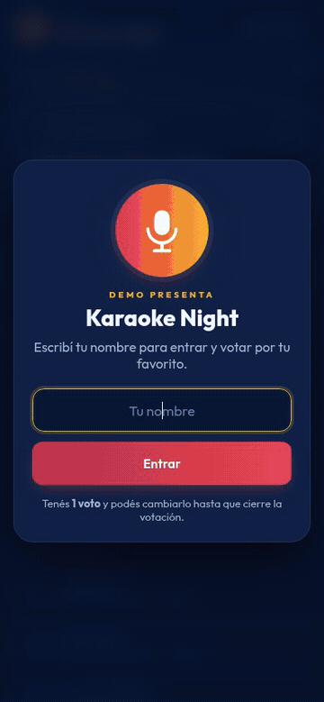
</p>

## Capturas

**Público** (lo que se abre con el QR)

<table>
  <tr>
    <td>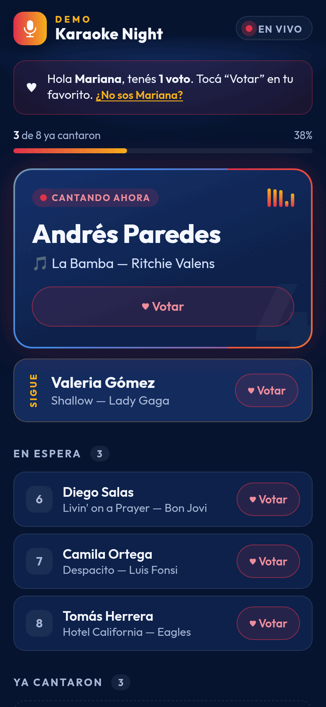</td>
    <td>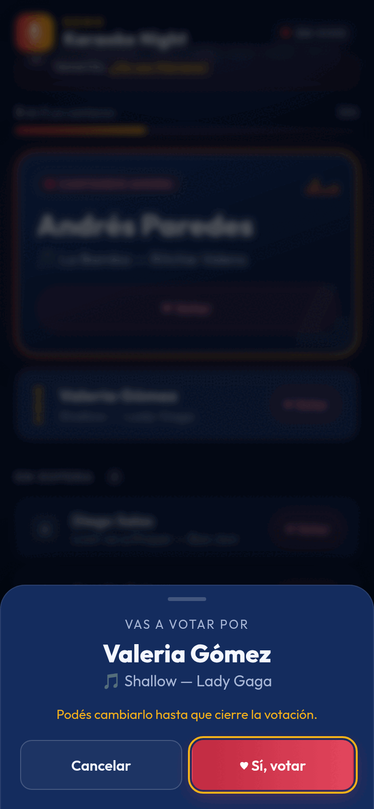</td>
    <td>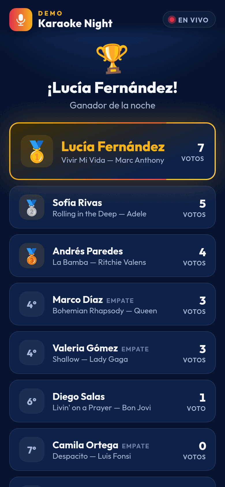</td>
    <td>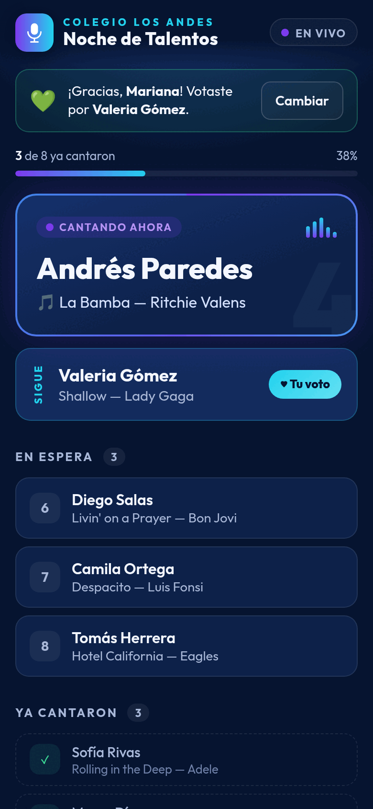</td>
  </tr>
  <tr>
    <td align="center">En vivo</td>
    <td align="center">Votar</td>
    <td align="center">Resultados</td>
    <td align="center">Con otra marca</td>
  </tr>
</table>

**Admin**

<table>
  <tr>
    <td>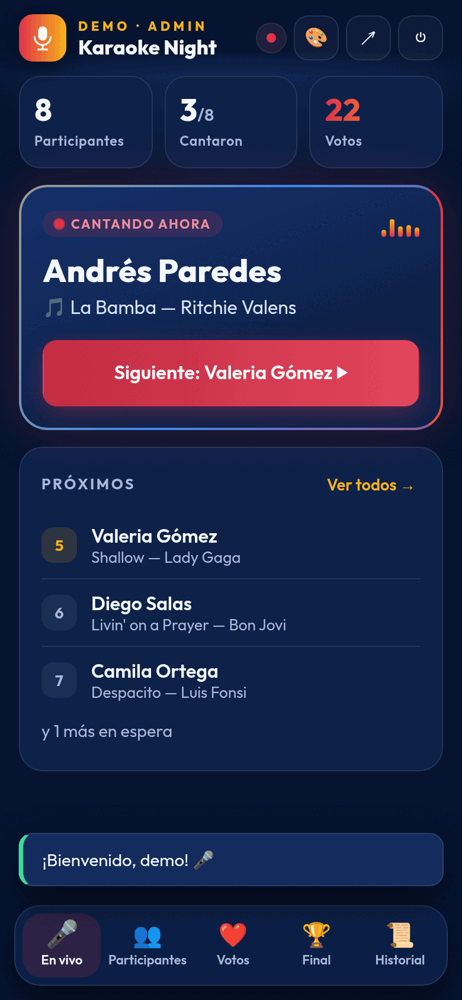</td>
    <td>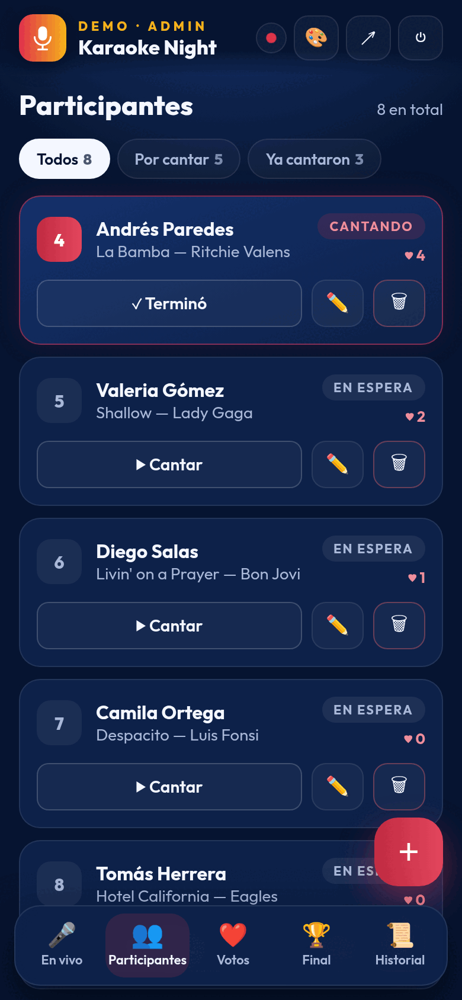</td>
    <td>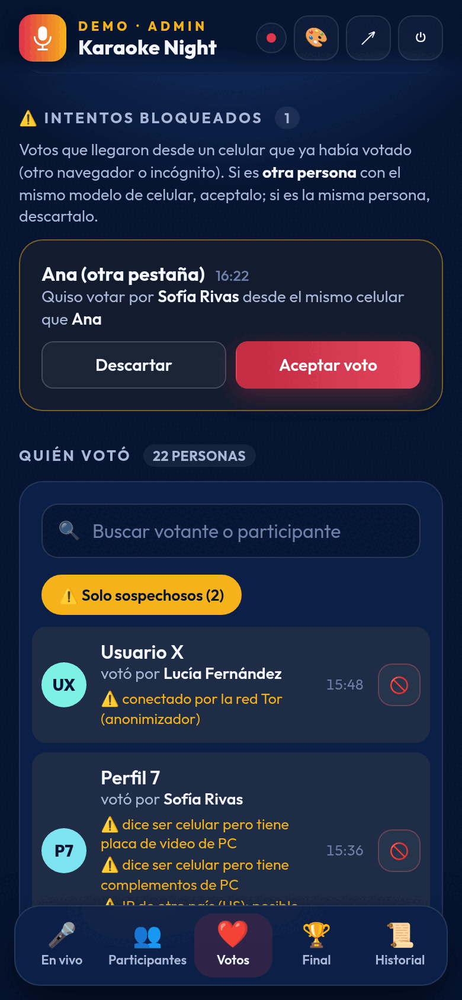</td>
    <td>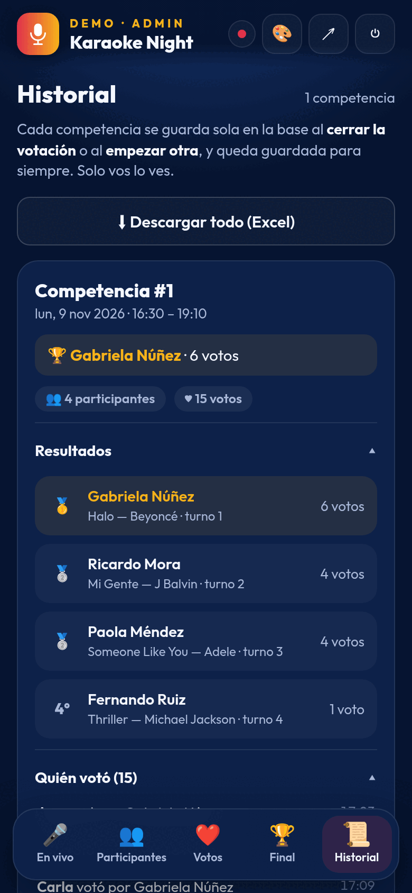</td>
    <td>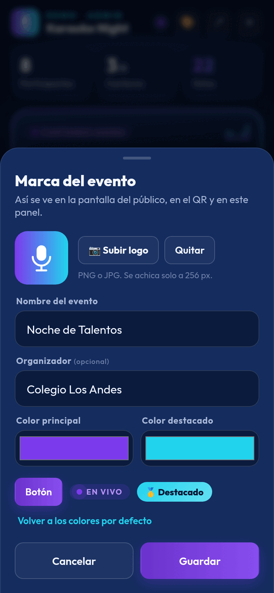</td>
  </tr>
  <tr>
    <td align="center">En vivo</td>
    <td align="center">Participantes</td>
    <td align="center">Votos sospechosos</td>
    <td align="center">Historial</td>
    <td align="center">Marca</td>
  </tr>
</table>

## Qué hace

**Para el público** (`index.html`)
- Pide el nombre y muestra en vivo quién canta, quién sigue y quién ya cantó.
- **Un voto por persona**, que se puede cambiar mientras la votación siga abierta.
- Al cerrar, los puestos aparecen de a uno, con la cantidad de votos, hasta el ganador.

**Para el organizador** (`admin.html`, con usuario y contraseña)
- **En vivo:** pasar de turno con un botón.
- **Participantes:** agregar, editar y borrar; elegir el turno (si pongo a alguien en
  el 2, los demás se corren solos). Los nombres se pueden corregir incluso después
  de revelar, y el público ve la corrección.
- **Votos:** ranking en vivo, quién votó a quién, intentos bloqueados y votos sospechosos.
- **Final:** cerrar la votación y revelar los puestos.
- **Historial:** todas las competencias, guardadas para siempre, con descarga a Excel (CSV).
- **Marca (🎨):** nombre del evento, organizador, logo y colores. Cambia en todos los
  celulares sin recargar. Sin configurar, todo queda con una marca neutra.
- **Nueva competencia / Otra ronda:** empezar de cero o repetir con los mismos participantes.

## Cómo funciona

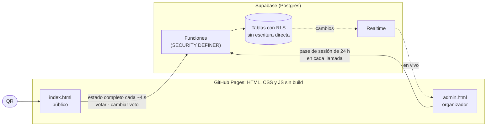

- **Sin servidor propio.** Las páginas son estáticas; toda la lógica que importa
  (turnos, votos, cierre, historial, permisos) vive en funciones de Postgres en
  [`schema.sql`](schema.sql). El navegador no puede escribir directamente en
  ninguna tabla: solo llama a esas funciones, que validan todo.
- **Demo sin backend.** [`demo.js`](demo.js) reemplaza al cliente de Supabase por
  una base simulada en `localStorage`, con las mismas funciones y reglas. La
  interfaz no sabe la diferencia: es el mismo código que en el evento real.

## Decisiones y límites

- **El público consulta cada ~4 s en vez de usar tiempo real.** El plan gratis de
  Supabase permite 200 conexiones en vivo, justo el tamaño del evento. Cada celular
  pide el estado completo en **una sola consulta**, con un poco de azar para que no
  lleguen todos juntos, no redibuja si nada cambió y consulta mucho menos con la
  pantalla apagada. Medido: 100 consultas simultáneas responden en ~1 s. El
  admin, que es uno solo, sí usa tiempo real.
- **Un voto por celular, sin pedir cuenta ni datos.** Nadie va a crear una cuenta
  para votar en un karaoke. Cada voto guarda una huella del hardware del celular
  (igual en todos sus navegadores, también en incógnito) y la IP real, que la base
  toma de Cloudflare y el navegador no puede falsificar. Misma huella **y** misma IP
  que un voto existente se bloquea, y el intento aparece en el admin para aceptarlo
  (otra persona con el mismo modelo de celular en el mismo WiFi) o descartarlo.
- **Votos sospechosos, sin bloquear.** Contra navegadores anti-detección (tipo
  AdsPower) que inventan una huella por perfil: la página revisa si el navegador
  "cuadra" (dice ser celular pero tiene placa de video o complementos de PC, no es
  táctil, está automatizado, el sistema o el reloj no coinciden) y la base anota el
  país de la IP (otro país, Tor). El voto se marca con el motivo y el organizador
  decide si lo anula. **Las IPs de los votantes no salen de Supabase**: no se
  consulta ningún servicio externo.
- **Límite honesto:** desde una página web no hay forma 100 % certera de identificar
  un celular. Quien cambie de red **y** de navegador puede votar de nuevo, y alguien
  con conocimientos técnicos podría falsificar huellas llamando a la API a mano.
  Para eso están las marcas de sospecha y el botón de anular. Para un evento
  presencial alcanza; para algo con premio en dinero haría falta verificar identidad.
- **La marca vive en la base**, con un número de versión. El logo (hasta ~300 KB) se
  descarga solo cuando cambia, no cada 4 s, y queda guardado en el celular para no
  mostrar la marca neutra ni por un instante al abrir.
- **Sin build ni framework.** Para un sitio de dos pantallas, HTML + CSS + JS directo
  se despliega en GitHub Pages tal cual y cualquiera puede leerlo. La librería de
  Supabase está fijada a una versión exacta (2.119.0) con verificación de integridad
  (SRI): si el CDN sirviera otra cosa, el navegador no la ejecuta.

## Seguridad

- La clave de Supabase que está en [`config.js`](config.js) es **pública por diseño**
  (la "publishable key"). Lo que protege los datos son RLS y las funciones.
- El usuario y la contraseña del admin **no están en el repo**: viven en una tabla
  privada, con la contraseña hasheada con bcrypt. Al entrar, la base entrega un pase
  que vence en 24 h; el navegador guarda el pase, nunca la contraseña. Los intentos
  fallidos tienen una demora para frenar a quien pruebe contraseñas en serie.
- El público no puede leer el historial, los votos bloqueados ni la configuración:
  solo lo que devuelven las funciones públicas.

## Montar tu propia copia

1. Crear un proyecto en [Supabase](https://supabase.com) y correr
   [`schema.sql`](schema.sql) en *SQL Editor*. Crea todo desde cero.
2. Elegir usuario y contraseña del admin (también en *SQL Editor*; cierra las sesiones abiertas):
   ```sql
   select fijar_clave_admin('usuario', 'contraseña');
   ```
3. Poner la URL del proyecto y la *publishable key* en [`config.js`](config.js).
4. Publicar la carpeta en GitHub Pages (o cualquier hosting estático) y generar el
   QR con la dirección de `index.html`.

Antes, conviene leer la [licencia](#licencia).

## Pruebas

[`pruebas.sql`](pruebas.sql) tiene **27 pruebas** de la base: turnos, votos, fraude
(mismo celular en incógnito, misma huella en otra red), moderación, cambio de voto,
cierre, revelación, corrección de nombres después de revelar, historial, nuevas
rondas, sospechas (AdsPower, Tor), marca y permisos (que el público no pueda leer
datos privados ni escribir directo en las tablas). Se pega en *SQL Editor* y se
corre; trabaja con datos de prueba y al terminar **deshace todo**, por eso termina
con un aviso en rojo a propósito: `PRUEBAS OK: 27 de 27` significa que todo anda.

El esquema se verificó creándolo desde cero en un proyecto vacío y corriendo ahí
las pruebas.

Las capturas y el GIF de este README se generan solos con
[`herramientas/capturas.mjs`](herramientas/capturas.mjs), que recorre la demo en un
Chromium sin ventana (Node 22+, Chromium y ffmpeg).

## Archivos

| Archivo | Qué es |
|---|---|
| `index.html`, `admin.html` | Las dos pantallas |
| `app.js`, `styles.css` | Código y estilos compartidos (marca, carga, animaciones, avisos) |
| `demo.js` | Base simulada para el modo demo (`?demo`) |
| `config.js` | URL y clave pública de Supabase |
| `schema.sql` | Tablas, permisos y funciones de la base |
| `pruebas.sql` | Pruebas automáticas de la base |
| `icono.svg` | Logo neutro por defecto |
| `docs/` | Capturas y GIF |
| `herramientas/capturas.mjs` | Genera las capturas y el GIF |

## Ideas a futuro

- **App instalable (PWA)** en vez de una app de tienda: se instala desde el navegador,
  sin pasar por Google Play ni App Store, y el QR sigue funcionando igual.
- **Varios eventos a la vez** para ofrecerlo como servicio: una tabla de eventos con
  su propio admin, marca y QR, cuentas reales para organizadores (Supabase Auth) y
  RLS por evento. Hoy la base maneja un evento a la vez.
- **Pantalla para proyector** con la revelación en grande.
- **Cobro por evento**, sin publicidad para el público. Stripe no opera en
  Venezuela, así que habría que usar una pasarela local o cobrar por fuera.

## Licencia

**Todos los derechos reservados** (ver [`LICENSE`](LICENSE)). El código está
publicado para que se pueda leer y evaluar; para usarlo en otro evento o proyecto,
pedime permiso.
